  

&nbsp;

## 👋 &nbsp;Sobre mim

Desenvolvo produtos web e mobile desde 2022. Hoje atuo como Desenvolvedor Web Pleno na **Forza Clubes**, trabalhando com Next.js, TypeScript, Chakra UI, C# e Claude.

Também já atuei no desenvolvimento de interfaces com React e Next.js, de APIs REST com Node.js, Express, Prisma e Sequelize, e de apps mobile com React Native, em projetos de saúde, agronegócio, comércio exterior e e-sports.

Uso IA no dia a dia de desenvolvimento com Claude Code e integro a Claude API a produtos para automatizar fluxos.

&nbsp;

## 🧰 &nbsp;Stack

| Área | Tecnologias |
|:--|:--|
| **Front-end** |          |
| **Back-end** |          |
| **Autenticação** |   |
| **Mobile** |    |
| **Dados** |    |
| **Qualidade e IA** |        |
| **Ferramentas** |      |

&nbsp;

## 🚀 &nbsp;Em produção

| Projeto | O que faz | Stack |
|:--|:--|:--|
| 🌎 [**ILG Comex**](https://www.ilgcomex.com) | Site institucional focado em SEO e performance, com rastreamento de envios (DHL, FedEx e UPS) e leads enviados direto ao CRM Bitrix. Depois do lançamento, a captação de clientes e o fechamento de novos negócios cresceram 40%. | `Next.js` `TypeScript` `Chakra UI` |

> *"O que mais me impressionou foi a preocupação dele com o desempenho do site e a experiência do usuário."*
>
> **Iluska Lopes**, diretora executiva da ILG Comex

&nbsp;

## 💼 &nbsp;Trajetória

| Quando | Onde | Destaques |
|:--|:--|:--|
| 2025 – hoje | **Forza Clubes** Desenvolvedor Web Pleno | Next.js, TypeScript, Chakra UI e C# |
| 2024 – 2025 | **Techlise** Estágio → Front-end → Desenvolvedor Web | Plataforma médica, Kanban com dnd-kit, app de chamadas com WebRTC + Socket.io e notificações push, e sistema de etiquetas DataMatrix com Node.js, Sequelize e Redis |
| 2024 – 2025 | **Freelancer** | Site da ILG Comex, site bilíngue com carrosséis 3D para a equipe de e-sports BloodHunts Gaming e site para a MClass Massoterapia |
| 2022 – 2023 | **AVMB Soluções em TI** Estágio | Portais web, app mobile em React Native e treinamento de novos estagiários |

🎓 &nbsp;Análise e Desenvolvimento de Sistemas · Unicesumar (2023 – 2025)

&nbsp;

🌐 <b>English version</b>

 

**Full-Stack Developer** building web and mobile products since 2022. I'm currently a mid-level Web Developer at **Forza Clubes**, working with Next.js, TypeScript, Chakra UI, C# and Claude.

I've also built interfaces with React and Next.js, REST APIs with Node.js, Express, Prisma and Sequelize, and mobile apps with React Native, for healthcare, agribusiness, foreign trade and e-sports projects. I use AI in my day-to-day development with Claude Code, and I integrate the Claude API into products to automate workflows.

**In production:** [ILG Comex](https://www.ilgcomex.com), a corporate website focused on SEO and performance, with shipment tracking (DHL, FedEx and UPS) and leads sent straight to the Bitrix CRM. After launch, lead generation and closed deals grew 40%.

**Experience:** Forza Clubes (2025 – now) · Techlise (2024 – 2025: healthcare platform, WebRTC + Socket.io calling app, DataMatrix label system with Node.js, Sequelize and Redis) · Freelance (2024 – 2025: ILG Comex, a bilingual website for the BloodHunts Gaming e-sports team and a website for MClass Massoterapia) · AVMB (2022 – 2023, internship)

